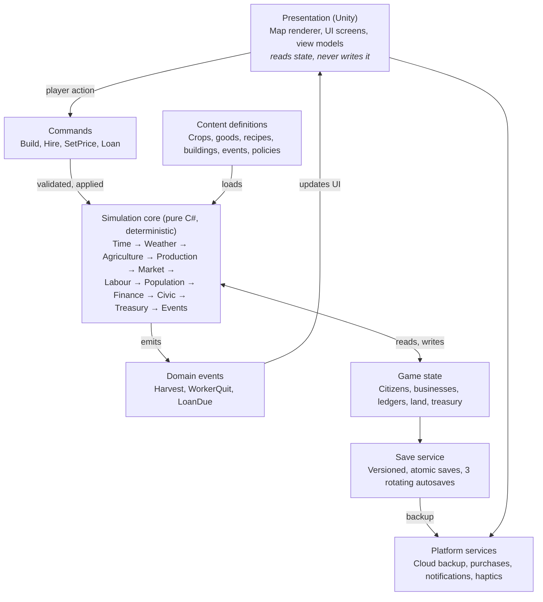
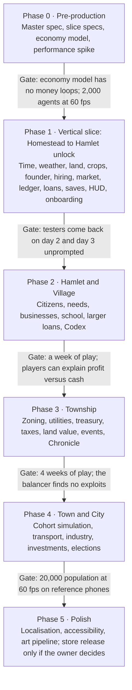

# Farm to City — Game Design Spec

Master spec · v1.2 · 17 Oct 2026 · Owner: Keyur Patel

> This is the master game design document (GDD). Feature specs in `docs/specs/` expand individual sections of it. When a feature spec and this doc disagree, update this doc in the same commit.

## Vision and pillars

Farm to City is an offline life-and-business simulation in Unity C# for iOS and Android. The player starts with one small plot of land and grows it into a city. Every building is a decision with real costs, and the town grows only as well as the player runs it.

**Design pillars**

1. **Real cause and effect.** Timers measure time; they never decide outcomes. Outcomes come from simulated supply, demand, skills, money and time.
2. **Learn by running it.** Lessons about business, assets and workforce sit inside the gameplay and are never delivered as lectures.
3. **Your town, your story.** There is no fixed path. A town that builds its school first should turn out different from one that builds a factory first.
4. **Calm, fair, offline.** No energy bars and no pay-to-win. The game plays fully offline from the first launch.

**Setting.** A fictional, Indian-inspired river valley: village and small-town life, monsoon seasons, local foods and festivals. Place names are invented, and the game avoids real geography, politics, religious figures and brands. Festivals and places of worship are generic and inclusive. See ADR 0001.

**Target player:** age 16 and up. Fans of Township, SimCity BuildIt, Stardew Valley and Banished, plus people who want to understand how money and businesses work. Sessions run 5–20 minutes on a phone and up to an hour on a tablet, several times a day. The town keeps running between sessions (see Time and world simulation).

**What "real life experience" means here:** real concepts with readable numbers. The game uses profit and loss, depreciation, interest, wages, productivity and price elasticity, at a simplified scale. One rule holds everywhere: every number shown can be explained in one tap with a *Why?* breakdown.

**Non-goals:** multiplayer, combat, real-money trading and photoreal 3D.

## Player journey and eras

The town moves through six eras, and each one changes the player's role, not just the size of the map. Eras unlock by what the town *is*, not by a counter: a town cannot become a Township without schooling and a clinic.

| Era | Player role | Unlock condition (what the player has built) | Population | New systems |
| --- | --- | --- | --- | --- |
| 1. Homestead | Farmer | Start: inherited 2-acre plot, a hut, a well, and savings covering about 2 seasons of living costs plus the first season's seeds (ADR 0008) | 1–3 | Crops, animals, selling to a travelling trader, cash ledger, small loans (moneylender, cooperative bank farm loans), day labour |
| 2. Hamlet | Landowner | 6 acres farmed, a house for a hired hand, one profitable season | 4–15 | Hiring, wages, storage, first processing (flour mill) |
| 3. Village | Village head | 5 households, a market stall, 1 business profitable for 2 seasons, a primary school (funded by the founder, ADR 0011) | 15–80 | Businesses, household needs, larger cooperative-bank loans, the treasury |
| 4. Township | Council chair | 20 households, a staffed clinic (the first doctor is a migrant), a road to the highway, 3 businesses, literacy above 40% | 80–500 | Zoning, taxes, water and power, land value, rentals |
| 5. Town | Mayor | Population 500, a secondary school, employment above 85%, a budget surplus | 500–3,000 | Public services, transport, industry, investments, elections |
| 6. City | Mayor and tycoon | Population 3,000, a college, a hospital, a power plant | 3,000–20,000 | Districts, trade with other cities, shares in businesses, specialisation |

**The founder.** The player is the town's founder: a named household that owns the personal wallet. The founder does not age and is not part of the citizen simulation, but the household has personal living costs every season. Citizens around the founder are born, age and retire. See ADR 0003.

**The founder's routine (ADR 0010).** The founder is the farm's first worker.

- Their labour tends the founder's own fields in the background, and the player taps to sow and harvest.
- The household runs on a plan the player sets once and pays upfront each season: a diet plan, working hours, and spending on clothing, health and other needs.
- Labour delivered each day = Hours × Nutrition × (1 − Fatigue) × Health.
  - Better food raises nutrition.
  - Long days build fatigue, and rest days and better housing clear it.
  - Poor food, overwork, unsafe water or too little warm clothing in Winter lower health and risk sick days.
- This is never an energy bar. It changes background output only, never blocks a tap, and can't be bought.
- The founder splits labour between their own fields and day labour for neighbours. The base capacity tends about 2–3 acres, so growing beyond that is the reason to hire.

**Two wallets.** The player's *personal wallet* holds their own farms, businesses and assets. From the Village era there is also a *town treasury*, funded by taxes and spent on public services. Keeping the two apart teaches the difference between personal and public finance. Using public money to favour your own businesses is possible, but it carries scandal risk.

**Town identity.** Cumulative choices give the town tags such as Agri-hub, Merchant town, Industrial town, Education town or Green town. Each tag unlocks unique buildings and small bonuses, so two playthroughs end in different cities.

**Span of play.** The game runs on real time. One game year is 16 real days, and reaching the City takes about 4–6 months of real time (about 10–12 game years). Citizens age on a faster life clock (1 life-year per season), so they are born, grow up, work and retire within one playthrough. See ADR 0002.

## Time and world simulation

The world runs on real time, like Hay Day or Township. Work you start keeps going while the app is closed, and you get a notification when it is done. Each season closes like a business quarter, with reports. See ADR 0002 for the full model.

**Three clocks**

1. **Task clock (real time).** Every job has a real-world duration from data:

   | Job | Duration |
   | --- | --- |
   | Onboarding crops (radish, greens) | minutes |
   | Wheat, onion | 4–8 hours |
   | Rice, potato | about a day |
   | Sugarcane, cotton | 2–3 days |
   | Orchard, first fruit | about 2 weeks |
   | Production batch (for example bread) | minutes |
   | Construction | hours |

   Jobs run whether the app is open or closed.
2. **Calendar.** 1 season = 4 real days, and 1 game year = 4 seasons = 16 real days.
3. **Life clock.** Citizens age 1 life-year per season. Childhood lasts about 72 real days, and a school pays off in about 40–60 real days.

**Clock rules**

- There are no speed controls and no pause in the live game, because no decision has to be made within seconds. Scenarios run in their own saves on an accelerated clock.
- The day/night lighting follows the device's local time. Citizens follow daily schedules: dawn (5–7), work (8–17), evening (17–21) and night.
- Settlement cadence:

  | Cadence | What settles |
  | --- | --- |
  | Every real hour | Production, movement, sales, and market prices clearing |
  | Every real day | Wage and rent costs are expensed in the P&L (no cash moves) and needs update |
  | Every season (4 days) | Accounts close; contracts renew, and the next season's wages, rent and living costs are paid upfront; utilities, taxes and loan payments are settled in arrears |
  | Every game year (16 days) | The year-end review and the Town Almanac |

**Seasons**

| Season | Farming | Economy |
| --- | --- | --- |
| Spring | Sowing for most crops | Seed and labour prices rise |
| Summer | Growth; water demand peaks | Heat lowers outdoor productivity |
| Monsoon | Main harvest | Crop prices fall from oversupply |
| Winter | Few crops; orchards and dairy carry on | Stored goods sell at a premium |

**Weather.** Weather changes in 6-hour spells, each drawn from the season's climate table: sun, cloudy, rain, heavy rain, heatwave, frost or storm. Weather changes crop yield (never crop duration), soil moisture, shop foot traffic, construction output and energy demand. A 3-day forecast lets the player prepare, and big events like droughts are signalled days ahead.

**Determinism.** Each save has a random seed. Sim time is a 64-bit count of seconds, kept separate from wall-clock time, and every command carries the sim time it applies at. The simulation is deterministic for a given seed and timestamped command history. That makes offline catch-up reproducible, makes bugs replayable, and allows automated balancing runs on a fake clock.

## Land, farming and livestock

Farming is the first business the player runs, so it introduces every core idea: input costs, yield risk, storage, and the trade-off between short-term profit and long-term asset value.

**Land.** Land comes in 1-acre tiles grouped into fields. Each tile has four properties:

- fertility (0–100)
- moisture
- soil type (loam, clay, sandy)
- drainage

The map grows as the player buys adjacent parcels. Price depends on soil and location.

**Crops (launch set).** Wheat, rice, maize, potato, tomato, onion, lentils, sugarcane, cotton, plus one multi-year orchard (mango or apple). Each crop defines:

- a sowing window (the seasons it can be sown in)
- a growth duration in real time
- water need
- base yield per acre
- labour hours per acre
- the soil nutrients it uses
- a base price

**Yield formula.** The yield breakdown is shown to the player on every harvest.

```
Yield = Base × Soil × Water × Care × Seed × Weather × Tools × Fertiliser × CropHealth
        capped at 1.6 × Base
```

- **Fertiliser:** none 1.00; compost 1.05 (raises fertility over the following seasons); chemical 1.25 (−3 fertility per season of use, applied pro rata per crop cycle).
- **CropHealth** starts at 1.0. An outbreak sets it to 0.4–0.8, and a rare severe outbreak sets it to about 0.
- **The cap** is in data, and the *Why?* breakdown shows when it applied (ADR 0014).

Care is the labour hours delivered divided by the hours needed, capped at 1.1. Labour comes from the founder (ADR 0010) and from hired workers. The Weather factor comes from the weather spells during growth.

**Ready to harvest.** A ripe crop waits in its field without spoiling or losing quality until it is harvested. While it waits, the field cannot be resown, so the cost of waiting is a lost crop cycle.

**Standing orders.** From the Hamlet era, hired workers follow standing orders, such as "keep wheat on the north field; sell above 20 coins, otherwise store". They work in the background, including while the app is closed. Fields with no assigned worker wait in *ready to harvest*.

**Inputs and trade-offs**

- **Seeds.** Buy certified seed (higher yield, costs more) or save your own (free, slowly degrading quality).
- **Fertiliser.** Chemical fertiliser gives +25% yield now but fertility falls 3 points a season. Compost from your own livestock is slower but builds soil. This teaches profit now versus land value later.
- **Crop rotation.** Repeating a crop drains its nutrient. Lentils restore soil, and leaving a field fallow for a season restores fertility.
- **Pests and disease.** Each crop cycle rolls a seeded risk. Risk rises with monoculture and wet weather, and falls with rotation and spraying, which costs money. Outbreaks are signalled during growth so the player can respond. Ignoring the risk can wipe out a field, but severe outbreaks never strike while the player is away.

**Irrigation ladder.** Rain-fed, then a well and buckets, then a canal channel, then drip irrigation. Each step costs more up front and makes yields more stable. This is the first lesson in capital spending versus operating spending.

**Livestock.** Chickens, goats, cows and buffalo. Each needs feed, shelter, health care and breeding. Animals produce eggs, milk, wool and manure, and the manure becomes compost. Vet bills and disease outbreaks are a real risk.

**Equipment ladder.** Hand tools, then an ox plough, then a tractor, then a harvester. Each machine has:

- a purchase price
- maintenance and fuel costs
- depreciation
- a resale value

Players can buy, lease, or hire a machine for a day from a neighbour.

**Storage and selling**

- Produce spoils at a rate set per good. A granary, and later cold storage, slows spoilage.
- **Sell or store?** Selling at harvest means low prices. Storing until winter means higher prices, but you pay storage and risk spoilage.
- **Contracts.** A trader can offer a forward contract: a fixed price for a quantity delivered next season. It protects you if prices fall and costs you if they rise. This introduces hedging.

## Economy

The economy is a local market that clears every real hour. Prices move with real supply and demand, and a regional trader sets a floor and a ceiling so prices never run away.

**Goods tiers**

| Tier | Examples | Made by |
| --- | --- | --- |
| Raw | Wheat, milk, cotton, timber, clay, stone, ore | Farms, forestry, quarries, mines |
| Processed | Flour, sugar, yarn, bricks, cement, dairy | Mills, kilns, plants |
| Finished | Bread, clothes, furniture, sweets, tools | Workshops, factories |
| Services | Meals, haircuts, tuition, healthcare, transport, lodging | Shops, clinics, schools, operators |

**Example production chains**

1. Wheat → flour mill → flour → bakery → bread
2. Cotton → gin → spinning mill → weaving → tailor → clothes
3. Clay → brick kiln → bricks → construction company → houses
4. Milk → dairy → paneer, curd, ghee → sweet shop
5. Sugarcane → jaggery or sugar mill → sweets, tea stall
6. Timber → sawmill → planks → carpenter → furniture

**Price model (ADR 0012).** Each good has a year-0 base price and an elasticity. The regional price follows inflation and the season, and the local price follows the ratio of demand to supply around it.

```
P_regional = P_base × PriceIndex × SeasonalFactor(good, season)
P_local    = P_regional × (Demand / Supply)^(1/e)
```

- **The working band comes from trade.**
  - Floor = `P_regional − TransportCost`. Below it, the regional trader buys.
  - Ceiling = `P_regional + TransportCost`. Above it, the trader imports.
- **Trader capacity.** The trader buys and sells only a limited quantity each day, so a large glut or shortage can briefly push the local price past the band until the next delivery.
- **Safety rail.** The local price is finally clamped to 0.5–2× `P_regional`. This only guards against bugs, and the balancer asserts that it almost never triggers.

- **Demand** comes from household consumption plus businesses buying inputs. It follows a demand curve, `D(P) = D_ref × (P / P_regional)^(−e)`, where `D_ref` is the demand at the regional price. The price formula is that curve solved for demand = supply (ADR 0013).
- **Supply** comes from local production plus the trader's import capacity at the ceiling, so it is never zero.
- **Prices drift, they don't jump.** Each hour the price moves 25% of the way toward its target (the rate is in data). The maths is fixed-point and needs no solver.
- **Shortages.** The quantity sold is `min(D, S)`. Buyers are served in a seeded, deterministic order, and unmet demand is recorded. It attracts competitors and feeds the shortage health check.
- **Scope.** This hourly market covers tradeable goods. Services are priced by the businesses that provide them, and customers choose between them (see Businesses, Customer choice).
- **Elasticity (e)** is the key lever. Necessities like flour have low elasticity: prices swing hard on shortages. Luxuries like sweets have high elasticity: overprice them and customers simply stop buying.

**Regional trader.** The trader buys from the town at the regional price minus transport, and sells to it at the regional price plus transport, up to a daily capacity. This creates import and export decisions. Transport cost depends on the road link, which explains why a town on a highway gets better prices than a remote one.

**Household spending.** Each household, the founder's included, splits its income across food, housing, clothing, education, health, leisure and savings. As income rises, the share spent on food falls and the share spent on education and leisure rises (Engel's law). A poor town needs grocers, and a rich town wants restaurants and tuition centres. That is market segmentation, learned by watching.

**Inflation.** There is mild inflation of 2–6% a year, driven by treasury spending and credit growth. Wage expectations follow it with a lag. Cash under the mattress quietly loses value, which teaches why saving and investing differ.

**Credit and payment terms.** From the Township era, sales between businesses use invoices with payment terms of half a season or a full season. A business can be profitable on paper and still run out of cash. That is one of the most important lessons in the game.

## Businesses

Every business is a small company with its own books, staff and customers. The player founds it, runs it, delegates it, sells it, or watches it fail.

**Catalogue by era**

| Era | Businesses |
| --- | --- |
| Hamlet | Farm stall, flour mill, dairy shed |
| Village | Grocery, bakery, tea stall, tailor, carpenter, brick kiln |
| Township | Restaurant, hardware store, private clinic, tuition centre, construction company, transport (tempo or truck) |
| Town | Hotel, textile mill, food processing plant, furniture factory, real estate developer, bus company |
| City | Bank, mall, IT services firm, hospital chain, logistics hub, export house |

**Founding flow**

1. **Pick a type.** Only types the era supports and the workforce can staff are offered.
2. **Market research.** A screen shows local demand, existing competitors and their prices, expected foot traffic on a heat-map, and the average wage for the roles needed.
3. **Business plan.** The player estimates price, volume and costs, and the game projects profit per season and break-even. The plan is saved, and after a year the game compares forecast with actual results.
4. **Location.** Buy land or rent a unit. Each spot gets a location score from traffic, nearby customers, competitors and rent.
5. **Funding.** Choose among:
   - own cash
   - a bank loan (rate, term, collateral)
   - an investor who takes an equity share
   - a partner citizen who shares profits and decisions
6. **Hire staff.** See Citizens and workforce.
7. **Set operations.** Prices, product quality, opening hours, stock reorder levels, marketing budget, supplier.
8. **Open.**

**Operating levers:** price, quality, staffing, hours, stock policy, marketing, supplier choice, equipment upgrades, expansion and automation.

**Customer choice.** Each customer picks a shop by comparing price, quality, distance, reputation and waiting time. Reputation runs from 0 to 5 stars, built from service quality, stock-outs and value for money. Underpricing wins customers but kills margin. Overpricing invites a competitor.

**Books for every business**

- **Profit and loss:** revenue, cost of goods, gross margin, wages, rent, utilities, maintenance, interest, depreciation, tax, net profit.
- **Cash flow:** profit adjusted for stock bought, prepaid wages and rent, loan principal, equipment purchases, and money still owed by customers.
- **Balance sheet:** assets, liabilities, equity.

Each line has a *Why?* tap with a plain-language explanation and the numbers behind it.

**Competition.** Computer-run rivals open when demand goes unmet and margins look good. Leaving a gap in the market, or charging too much, attracts competitors, just as in real life. Rivals can also close, merge, or offer to buy you out.

**Lifecycle and trouble.** New businesses usually lose money for their first 1–3 seasons. Trouble arrives as events: a supplier shortage, a key worker quitting, a health inspection, a price war, a road closure, a viral rush of customers.

**Failure is a lesson, not game over.** When cash falls below zero, the business uses an expensive overdraft. If that runs out, wages are missed, staff leave and suppliers stop delivering. The player can then:

- inject personal cash
- restructure the loan
- sell assets
- close the business

The player's credit score drops, and later loans cost more. This applies to a business's own books. Personal bankruptcy, where the founder's own debts default, is covered under Assets and wealth.

**Delegation.** The player can hire a manager to run a business, which is the only way to scale beyond a handful of businesses. Each manager has a skill level and a style: cost-cutter, growth-chaser, or quality-first. The player receives seasonal reports and sets targets.

**Exit and valuation.** A business can be sold at a valuation of about 3–6x its annual profit, adjusted for growth and risk. Its value shows on the player's net worth. Successful businesses can open branches or become franchises.

## Citizens and workforce

Every citizen is a person with skills, a family and ambitions. Managing them well, through fair pay, training, structure and respect, decides how far the town gets.

**Citizen profile**

| Field | Detail |
| --- | --- |
| Identity | Name, age, household, home, portrait |
| Life stage | Child (0–17), adult (18–59), elder (60+) |
| Education | None, primary, secondary, college, specialist |
| Skills (0–100) | Farming, crafting, sales, service, construction, management, teaching, medicine, engineering, finance |
| Traits (2–3) | Hardworking, lazy, ambitious, loyal, creative, careless, frugal, sociable, perfectionist |
| State | Health, happiness, fatigue, job satisfaction, savings, wage expectation |
| Story | Where they came from, life events, and their relationship with the player |

**Population flows**

- **Births** depend on households, housing space, happiness and healthcare.
- **Migration in** is pulled by open jobs, wages, housing, services and town reputation.
- **Migration out** is pushed by unemployment, unhappiness, and better wages in other towns.
- **Ageing and deaths** follow life expectancy, which healthcare, sanitation and nutrition raise.

**Hiring**

1. **Post a job:** role, wage, hours, required skills, benefits.
2. **Receive applicants:** unemployed citizens, citizens already employed but looking, and migrants.
3. **Review candidates.** Skills are shown as ranges, and traits are partly hidden. An interview reveals one trait, and a reference check reveals another. This teaches hiring under uncertainty.
4. **Make an offer.** Candidates can accept, reject, or negotiate the wage.
5. **Probation:** one season, during which the employee can be let go without severance.

**Wages.** Workers are hired on season-long contracts at a fixed wage per season, paid upfront at the start of each season (ADR 0008). The wage is renegotiated at renewal. If the player can't afford a renewal, the contract lapses. A worker who leaves mid-season returns the unearned part, less any severance. Prepaid wages sit on the balance sheet and are expensed day by day, which is the game's main example of profit not being cash. Each skill level has a market wage, set by labour supply and demand and nudged by inflation. Paying above market raises loyalty and applicant quality. Paying below market raises quit rates and invites poaching. Later eras add minimum wage policy and worker associations.

**Productivity.** Output depends on five factors, and each is shown in the worker's panel.

```
Output = Skill × Motivation × Tools × RoleFit × (1 − Fatigue)
```

Motivation comes from wage fairness, manager quality, working conditions, recognition and growth.

**Hours and shifts.** Overtime raises output, but fatigue and accident risk climb with it. Night shifts need a premium. Rest days restore fatigue.

**Training.** Skills grow by on-the-job experience, by paid courses (cost plus time away from work), or by sponsoring a citizen's education in return for a work bond. A trained worker is worth more, and is worth more to competitors, too.

**Structure and span of control.** Roles run worker → senior → supervisor → manager. One supervisor manages 5–8 people well. Beyond that, productivity and quality decay, which teaches why organisations need structure.

**Benefits.** Meals, health cover, housing, bonuses and paid leave. Each has a cost and a morale effect.

**HR events.** A raise request, a resignation, a poaching offer, a conflict between two workers, sick leave, a family emergency, a workplace accident, a petition for better conditions. Each event offers choices with consequences.

**Letting people go.** Firing costs severance and lowers the morale of colleagues. Fair treatment builds an **employer reputation** score, which decides the quality of future applicants.

**Children go to school, not to work.** The game never allows child labour. Children attend school if one exists, and that education turns into a better workforce 10–15 life-years later (about 40–60 real days).

## Community and civic services

Happiness comes from layered household needs, and civic buildings meet them only when they are staffed and within reach. A school with no teachers is just a building.

**Needs layers.** Happiness is a weighted score of how well each layer is met. A lower layer must be mostly met before the higher ones count fully.

1. **Survival:** food, water, shelter.
2. **Security:** a stable job, healthcare, safety.
3. **Belonging:** community hall, market square, festivals, places of worship and culture.
4. **Growth:** education, library, sports, leisure, culture.

**Civic buildings**

| Service | Early form | Late form | Needs staff | Effect |
| --- | --- | --- | --- | --- |
| Water | Well | Water tower, treatment plant | Engineers | Health, growth limit |
| Education | Primary school | Secondary school, college, library | Teachers | Skills, literacy, era unlocks |
| Health | Clinic | Hospital | Doctors, nurses | Life expectancy, fewer sick days |
| Safety | Watchman | Police station, fire station | Officers | Crime and fire risk |
| Community | Banyan-tree square | Community hall, stadium | Caretakers | Belonging, festivals |
| Leisure | Playground | Park, cinema, museum | Staff | Happiness, tourism |

**Coverage and capacity.** Each service has a radius and a capacity, such as seats or beds. Homes outside the radius get no benefit, and overcrowding lowers quality. Staff come from the workforce, so a clinic needs a doctor. Education, migration or a scholarship must produce one.

**Literacy versus skills (ADR 0011).** Education pays off at two speeds.

- **Literacy** (the share of residents aged 7+ who can read) comes quickly. A child becomes literate after 4 life-years of primary school, about 16 real days. Adult literacy classes at the school take about 1 season. Migrants also arrive with some education.
- **Skilled graduates** come slowly (below).

The first primary school is funded by the founder, from the personal wallet or a cooperative-bank loan. The first professionals, such as the Township clinic's doctor, are migrants attracted by housing and above-market wages. Locally educated professionals become possible from the Town era.

**Education as a long-term investment.** A school's skilled payoff comes 10–15 life-years later (about 40–60 real days), as skilled adults who can staff clinics, engineering firms and banks. Literacy rate is a visible town statistic that gates later eras. Investing for the future is the hardest lesson, and the game makes it visible.

**Health.** Clean water, sanitation, nutrition and healthcare raise life expectancy and cut sick days, which feeds straight back into productivity.

**Safety and fairness.** Crime rises with unemployment and inequality. Police lower crime, but jobs and fair wages lower it more cheaply. An inequality indicator tracks the gap between the richest and poorest tenth of the town. High inequality causes unrest and out-migration.

**Festivals.** The player schedules festivals at a cost. They bring a happiness spike, visitors and trade, and they become memorable entries in the Chronicle.

**Town reputation** has five scores: livability, business climate, education, health and environment. They attract migrants, investors and regional grants.

**Citizen voice.** Citizens raise petitions such as "We need a school closer to the east side." Petitions show what the town needs and feed the approval rating.

## City building

The player places their own farms, businesses and civic buildings directly. From the Township era they also zone land, and private builders fill the zones when demand exists. The player shapes the city, and the city then grows itself.

**Map.** An isometric tile grid set in a river valley. The terrain includes:

- fertile plain
- forest
- hills
- rocky land
- a river

The map holds deposits of clay, stone, timber and ore. Land outside the starting plot is bought parcel by parcel, and prices rise as the town develops.

**Zoning (from Township):** residential, commercial, industrial, agricultural and mixed use. Each zone has a density level that rises with land value and with infrastructure.

**Construction is real work.** Every building needs:

- materials (bricks, timber, cement, steel)
- builders
- time

The player can buy materials, produce them, or own the construction company. A shortage of bricks really does slow the city.

**Roads.** Dirt path, then gravel, then paved road, then avenue. Each step raises capacity and speed. Congestion appears in the Town era and raises delivery costs and commute times.

**Utilities**

| Utility | Ladder | Without it |
| --- | --- | --- |
| Water | Well → tower → treatment plant | Growth capped, disease |
| Power | None → diesel generator → grid plant → solar or wind | No factories, no night shifts |
| Sanitation | Pit → drains → sewage plant | Disease, lower land value |
| Waste | None → collection → recycling | Pollution, unhappiness |

**Land value** rises with nearby services, parks, roads and jobs, and falls with pollution, noise and crime. It drives rents, property tax and what private builders choose to put up. An overlay shows it at any time.

**Pollution** comes from industry, traffic and diesel power. It lowers health and land value. Clean alternatives cost more up front, which makes them a real decision.

**Transport.** Citizens walk to places within a radius. A bus network extends that radius, and trucks move goods between businesses. Logistics cost shows up in every business's books.

**Building upgrades.** Hut → house → villa, or row house → apartment block. Upgrades depend on land value, household income and infrastructure. The skyline grows from what the town can actually support.

## Governance and public finance

From the Village era the player also runs the town treasury. Public money pays for public goods, and every tax and policy has winners, losers and a lag.

**Revenue**

- property tax, based on land value
- business tax on profit
- sales tax
- fees for market stalls, licences and building permits
- regional grants, which come with conditions
- municipal bonds and loans

**Spending**

- staff wages for public services
- maintenance
- new construction
- subsidies
- interest on public debt

**Budget cycle.** At the start of each year the player sets an annual budget by department, and can revise it once at midyear. Each season the game reports actual spending against budget, with variances explained. Overspending a department drains the treasury, and underspending lets services decay.

**Policies.** Each policy has a cost, an effect and a lag. The launch set:

| Policy | Helps | Costs |
| --- | --- | --- |
| Free school meals | Enrolment, child health | Treasury spend |
| Farm input subsidy | Farm incomes, food supply | Treasury; dependency risk |
| Small business grant | New businesses | Treasury; some grants wasted |
| Minimum wage | Worker income, fairness | Higher business costs, fewer jobs at the margin |
| Rent control | Affordability | Less new housing built |
| Pollution limits | Health, land value | Industry costs; some firms leave |
| Tourism promotion | Visitors, hotels, restaurants | Marketing spend; crowding |
| Night market | Retail, nightlife | Noise; police cost |

**Approval and elections.** Approval comes from happiness, jobs, tax levels and fulfilled petitions. From the Town era there is an election every 5 game years (80 real days). Low approval limits how much tax citizens accept and slows migration into the town. The player never loses office (ADR 0004). Instead, the election result sets the **council mood** for the next term:

| Council mood | Effect for the term |
| --- | --- |
| Supportive (high approval) | Higher tax ceiling, more policy slots, eligible for regional grants |
| Neutral | Baseline ceilings and slots |
| Hostile (low approval) | Lower tax ceiling, fewer active policies, budget revisions need a council vote that can fail, unanswered petitions escalate into protests |

The thresholds live in data. The mood lasts until the next election, so recovering means governing well for a term.

**Public debt.** Bonds fund big infrastructure such as a power plant or a highway link. The town has a credit rating that sets its interest rate. Too much debt crowds out services, which is a direct lesson in leverage at public scale.

**Conflicts of interest.** Treasury money can build a road to the player's own factory. Doing it repeatedly creates a scandal risk that hits approval and reputation. The game never preaches about this. It simply has consequences.

## Assets and wealth

The player's real score is **net worth**: everything they own minus everything they owe. Coins in hand are only part of it. The game teaches why some assets grow, some shrink, and some pay you while you sleep.

**Asset classes**

| Asset | Value over time | Income | Liquidity | Lesson |
| --- | --- | --- | --- | --- |
| Cash | Loses value to inflation | None | Instant | Keep an emergency fund, not a hoard |
| Savings deposit | Grows at bank interest | Interest | 1 day | Compounding |
| Farmland | Appreciates as the town grows | Crop profit or lease rent | Slow sale at a discount | Land as a long-term store of value |
| Buildings | Depreciate; maintenance slows it | Rent or business use | Slow | Upkeep is a real cost |
| Equipment and vehicles | Depreciate fast | Through productivity | Medium | Buy or lease? |
| Livestock | Grows by breeding; risk of disease | Milk, eggs, wool | Medium | Living assets carry risk |
| Businesses | About 3–6x annual profit | Profit | Slow, needs a buyer | Building versus buying cash flow |
| Rental property | Tracks land value | Rent minus vacancy and upkeep | Slow | Passive income, yield |
| Town bonds | Stable | Fixed coupon | Medium | Low risk, low return |
| Shares (City era) | Volatile | Dividends | Fast | Diversification |

**Depreciation.** Every building and machine loses book value each season on a straight-line schedule. Skipping maintenance speeds wear, then causes breakdowns and accidents. Market value can differ from book value, and the game shows both.

**Leverage.** Loans let the player buy assets sooner. If the asset returns more than the interest, wealth grows faster. If it doesn't, debt grows faster. Defaulting on a secured loan means the bank takes the collateral.

**Credit (ADR 0009).** Borrowing is available from day one:

| Lender | Available from | Rate | Terms |
| --- | --- | --- | --- |
| Village moneylender | Homestead | High (about 3–5% a season) | Small amounts, no collateral |
| Cooperative bank | Homestead for farm loans, larger loans from Village | Low (about 2–3% a season) | Needs collateral and a credit score |

Each lender has a credit limit set by collateral, credit score and recent income, and the player can't borrow past it. Missed payments add penalty interest and lower the credit score. A payment overdue past the grace period is a default.

**Personal bankruptcy is foreclosure, not game over.**

- The lenders seize the founder's collateral: bought land, buildings, equipment, livestock and businesses.
- The inherited 2-acre plot and hut are protected and can never be seized.
- Remaining debt is written off.
- The credit score drops sharply and recovers slowly.
- The town, its citizens, the treasury and the Chronicle carry on, and the founder starts again from Homestead level.

**Never stuck.** The founder can always work as a day labourer for neighbours, earning a small daily income at the unskilled market wage. When living costs can't be paid, the household drops to subsistence level instead of going into debt.

**Liquidity.** Land and businesses take days to sell and sell at a discount if rushed. A player with all their wealth in land and no cash can still go bankrupt in a bad season.

**Diversification.** One crop, one business or one customer is fragile. Events hit specific sectors, and a spread of assets smooths the shocks.

**Personal finance screen**

- net worth trend
- an asset allocation pie chart
- the passive income ratio: income that arrives without the player's labour, against spending per season
- the debt-to-asset ratio
- an emergency fund measured in seasons of costs covered

**Wealth milestones** mark progress without telling players what to do: first 10,000 coins of net worth, first rental income, debt-free, passive income covering living costs.

## Events, disasters and town history

Events test the player's preparation and always offer a choice. The Chronicle turns the town's history into a story the player feels attached to.

**Event families**

| Family | Examples | Preparation that softens it |
| --- | --- | --- |
| Weather | Drought, flood, heatwave, hailstorm | Irrigation, drainage, crop insurance, diversified crops |
| Economic | Regional price boom, recession, new highway, fuel spike | Cash reserve, contracts, diverse businesses |
| Business | Supplier strike, viral popularity, health inspection, equipment breakdown | Second supplier, quality standards, maintenance |
| Workforce | Mass resignation, skilled migrant arrives, poaching war | Fair wages, training, employer reputation |
| Social | Wedding, festival, new family, a dispute between neighbours | Community spaces, happiness |
| Opportunity | Investor offer, trade contract, regional grant, land auction | Good books, credit score, reputation |
| Disaster | Fire, epidemic, river flood | Fire station, hospital, embankment, insurance |

**Event rules**

- Every event offers 2–3 choices with visible short-term costs and hinted long-term effects.
- What the player prepared changes the impact. This shows the value of insurance and reserves.
- Frequency: about one minor event a real day and one major event a game year (16 real days). Disasters are rare and signalled days ahead, and never fire while the player is away.
- Events are weighted by the town's state. A drought is more likely after a dry season, and a strike more likely after wage cuts.

**Insurance.** Crop, property and business-interruption insurance are available. The player pays a premium every season, and a payout follows when a covered event strikes. Players learn the trade-off between a certain small cost and an uncertain large one.

**The Chronicle.** An automatic history of the town:

- the first settler's name
- the first child born in town
- the first graduate
- record harvests
- disasters survived
- businesses founded and lost

Entries are written in a warm, slightly poetic voice, and they become the emotional heart of the game.

**Town Almanac.** At each year's end, a short illustrated summary: population, net worth, the year's best decision, its costliest mistake, and a citizen spotlight.

**Citizen stories.** Notable citizens get small arcs. A hired hand saves up and opens a tea stall. A scholarship child returns as the town's first doctor. Arcs arise from the simulation, not a script, and are surfaced as short vignettes.

## Learning layer

The game teaches in three steps: the player decides, sees the result, and only then gets the concept named. A lesson the player felt lands harder than one they read.

**Advisors.** Four characters comment on reports in plain language. They warn and explain, but never make the decision.

- **Farm advisor:** soil, crops, weather risk.
- **Accountant:** margins, cash flow, loans, assets.
- **People lead:** hiring, morale, training, structure.
- **Town planner:** coverage, land value, budget, policies.

**Reports every player can read**

| Report | Cadence | Teaches |
| --- | --- | --- |
| Cash ledger | Daily | Where money goes |
| Profit and loss | Each season | Margins, fixed and variable costs |
| Cash flow statement | Each season | Profit is not cash |
| Balance sheet | Each season | Assets, liabilities, equity |
| Workforce report | Each season | Turnover, productivity, wage benchmarks |
| Town report | Each season | Services, happiness, budget against actual |
| Year-end review | Yearly | Best decision, costliest mistake, what to try next |

**Concept Codex.** About 40 concept cards unlock the first time the player meets each idea in play. Every card has a plain definition, the player's own numbers as the example, and a one-line real-world link. Launch set:

- **Business:** gross margin, break-even, fixed versus variable cost, unit economics, pricing power, competition and market entry, forecast versus actual.
- **Money:** cash flow versus profit, working capital, interest and compounding, inflation, credit score, leverage, liquidity, emergency fund.
- **Assets:** depreciation, appreciation, yield, valuation, diversification, insurance, hedging, opportunity cost.
- **People:** hiring under uncertainty, market wage, retention, training ROI, span of control, delegation, employer reputation.
- **Public:** public goods, taxes and services, externalities such as pollution, inequality, long-term investment.

**Business plan tool.** Before founding a business, the player fills in a simple plan. After a year the game puts the plan beside actual results. Seeing your own optimism measured is a real-world planning skill.

**Scenarios.** Short standalone challenges with a grade from A to F. Each runs in its own save on an accelerated clock, so a scenario year takes minutes, not 16 days:

- Save a failing bakery within one year.
- Get through a two-season drought without layoffs.
- Staff a clinic from scratch.
- Pay off a big loan before it falls due.
- Grow a town with no farmland.

**Difficulty modes**

- **Guided:** more advisor warnings, softer price swings, and big decisions always ask for confirmation.
- **Standard:** the default.
- **Realistic:** harsher markets, fewer hints, hidden traits stay hidden longer.

**Accuracy.** All models are simplified but point the right way. Before launch, friends and relatives with the expertise review the Codex and core formulas for finance accuracy, and the names, festivals, foods and art for cultural accuracy (ADR 0001, ADR 0007).

## Decisions and consequences

Every decision in the spec has four parts, and each feature spec must fill them in:

1. the immediate cost
2. the delayed effect
3. the side effects on other systems
4. how reversible it is

The town's future comes from the sum of these. A script never decides it.

**How a decision ripples: building a school**

1. The school costs coins and materials, and takes builders off other jobs.
2. It needs teachers. The player hires them, trains them, or offers housing to attract migrants.
3. Families with children rate the town higher, and migration rises.
4. After 10–15 life-years (about 40–60 real days), graduates enter the workforce with higher skills.
5. Skilled workers unlock clinics, engineering firms and banks, and wages rise.
6. Land value near the school rises, and so do property tax receipts.

**Trade-off examples**

| Decision | Short term | Long term | The lesson |
| --- | --- | --- | --- |
| Chemical fertiliser | +25% yield | Soil fertility falls 3 points a season | Profit now versus asset value later |
| Pay 15% above market wage | Higher costs | Lower turnover, better applicants | Margin versus stability |
| School before factory | No revenue for years | Skilled workforce | Patience compounds |
| Loan to expand | Interest cost | Faster growth; danger if sales dip | Leverage cuts both ways |
| Undercut a rival's price | Thin margins | Rival exits, or you run out of cash first | Price wars |
| Skip maintenance | Saves cash | Breakdowns, accidents | Operating cost versus reliability |
| Factory near homes | Jobs, taxes | Health and land value fall | Externalities |
| Promote from within | Training cost | Loyalty, knowledge kept | Investing in people |

**No single best strategy.** Balancing must keep at least three town archetypes viable, such as the agri-hub, the merchant town and the education town. The best archetype's median net worth and median happiness must be within 20% of the worst archetype's on the standard benchmarks (ADR 0016).

**Mistakes are recoverable.** Bankruptcy (foreclosure, ADR 0009), a failed harvest or a hostile council costs time and wealth, but never ends the save. A new game is always the player's choice. Real life rarely gives a game over, and the learning comes from recovering.

## UI/UX and screens

The map is the home screen, and any lever is at most three taps away. The UI itself ages with the town: wood and paper in the Homestead era, modern glass in the City era.

**Screen list**

| Screen | Purpose | Key elements |
| --- | --- | --- |
| Map | Watch and place | Isometric map, pinch-zoom, tap to select, ghost placement preview |
| HUD | Status at a glance | Date, season, weather, personal cash, treasury, population, happiness, ready-to-collect count, alerts |
| Build menu | Construct | Categories by era, cost and material check, coverage preview |
| Overlays | See the hidden | Fertility, land value, coverage, pollution, traffic, happiness, crime |
| Building panel | Inspect | Status, staff, inputs and outputs, upgrades, financials tab |
| Business dashboard | Run a company | KPIs, profit and loss, levers, manager, plan against actual |
| People | Workforce | Citizen list and profiles, family tree, hiring board, workforce report |
| Finance hub | Personal money | Ledger, statements, loans, assets, net worth |
| Town hall | Public money | Budget, taxes, policies, petitions, approval |
| Advisor inbox | Guidance | Warnings, tips, event choices |
| Codex | Learn | Concept cards, scenario list |
| Chronicle | Remember | Timeline, Almanacs, citizen stories |
| Settings and saves | Control | Save slots, backup, difficulty, accessibility, language |

**Onboarding (ADR 0015).** A short first session, then a guided first week. The grandparent's letter and the advisors guide each lesson, never a pop-up wall.

- **First session (15–20 minutes):** inherit the neglected 2-acre plot and the letter. Sow a quick crop, set the household plan, harvest and make the first sale to the travelling trader. Then sow a long crop, turn on notifications, and leave with a reason to come back.
- **Guided first week:** each "first" is guided once, when it naturally happens, by a new letter page:
  - the first return (*While you were away*, *ready to harvest*)
  - the first season close (P&L, prepaid costs)
  - the first loan offer, only when land or cash runs short, comparing moneylender and bank, never pushed
  - the first hire, once fields exceed the founder's labour (contracts, standing orders)
  - the first school, at the Village unlock
- Letter chapters can be reopened at any time.

**Mobile ergonomics**

- The game is landscape only, on phones and tablets, in both landscape directions (ADR 0005). Menus work one-handed from bottom sheets, and the main actions (collect all, harvest, build) sit in thumb reach in the bottom corners.
- Layouts support phone aspect ratios from 16:9 to 21:9, 4:3 tablets, and notch and home-indicator safe areas.
- Touch targets are at least 44 pt. Long-press shows the *Why?* breakdown on any number.
- Notifications group by importance: urgent (cash, safety), decisions, then information.
- No decision is ever timed. Big decisions show their consequences before confirming.

**Accessibility.** Colour-blind-safe overlay palettes, scalable text, reduced-motion mode, haptic feedback that can be switched off, and full play without audio.

**Localisation.** English first, with Hindi and other languages after launch. All text lives in string tables from day one, and numbers format by locale.

## Offline play and saves

The game needs no account and no server. All content ships in the build, and the network is used only for optional cloud backup and store purchases.

**Time while the app is closed.** The town keeps living in real time for up to **72 real hours** per absence (ADR 0002). Crops grow, and workers follow their standing orders. After 72 hours the world freezes, and it resumes from that point when the player returns. A *While you were away* report shows harvests, sales, wages paid and events.

**Away rules**

- Disasters never fire while the player is away.
- Events that need a decision queue and wait for the player.
- Workers who are paid for the season keep working. Contracts that can't be renewed lapse. Nothing pushes the player into debt automatically while they are away (ADR 0008).

**Catch-up.** On resume, the game issues one `AdvanceTo(simTime)` command, computed from the wall clock. The scheduler then runs the same hourly, daily and seasonal passes as live play, so there is no separate coarse model. At most 72 hourly passes are needed.

**Clock safety.** The game stores the last-saved wall-clock time. A backward jump grants nothing. A forward jump is capped at 72 hours, as above. Changing the device clock cannot be fully prevented offline. With no paid speed-ups, a player who does it only cheats themselves.

**Save system**

- **Autosave** every real hour, after every command batch, and whenever the app goes to the background.
- **Slots:** 3 rotating autosaves plus 5 manual slots.
- **Atomic writes:** write to a temporary file, verify its checksum, then rename. A crash can never corrupt the last good save.
- **Format:** versioned binary such as MessagePack, compressed. Every save carries a schema version, and migration functions upgrade older saves on load.
- **Size target:** under 5 MB at City scale.
- **Backup:** manual export and import of a save file. iCloud on iOS and Google Play Games Saved Games on Android come later, only if the game is published to the stores (ADR 0007).
- **Distribution, for now:** personal builds only. iOS uses a free developer account, with the build re-signed every 7 days. The bundle ID and signing team stay fixed, so the save data survives reinstalls. Android uses sideloaded APKs signed with the owner's key. These builds contain no purchases: the full game is unlocked.

**Local notifications** work without a network, for example "Wheat in the north field is ready" or "Loan payment due tomorrow". They are scheduled from known finish times when the app goes to the background. They are opt-in, grouped, and capped at 2 a day.

**Performance budget**

| Target | Value |
| --- | --- |
| Frame rate | 60 fps on iPhone 11 and on a 4 GB Android phone from 2021 |
| Fully simulated citizens | Up to about 2,000 |
| Total population | 20,000, beyond the first 2,000 simulated as statistical cohorts with named notable citizens |
| Cold start | Under 5 seconds to the map |
| Offline catch-up | Under 2 seconds for 72 hours away |
| Battery | Low-power mode when idle; capped frame rate in menus |

## Technical architecture (Unity C#)

The simulation is a pure C# library with no Unity dependency. Unity only draws the state and sends commands. This keeps the game logic testable, deterministic and fast enough to run 100 game years headless in a balancing test.



The UI sends commands down and listens for events coming up. Only the simulation changes game state.

**Layers**

1. **Content definitions.** Crops, goods, recipes, buildings, events, policies and Codex cards, authored as data rather than code.
2. **Command layer.** UI actions become commands such as `BuildCommand`, `HireCommand`, `SetPriceCommand` and `TakeLoanCommand`. The simulation validates each one and rejects it or applies it. This works like CQRS in a backend: one entry point for every state change, easy to log, replay and test.
3. **Simulation core.** A scheduler advances sim time. It processes every due job in timestamp order, plus the hourly, daily, seasonal and yearly settlement passes. Within a pass, systems run in a fixed order: Time → Weather → Agriculture → Production → Market → Labour → Population → Business finance → Civic → Treasury → Events. Ties are broken by system order, then by entity id. Each system reads and writes `GameState` only.
4. **Game state.** Plain serialisable C# objects and struct arrays. This is the single source of truth.
5. **Domain events.** Each settlement pass and each finished job emits events like `HarvestCompleted`, `WorkerQuit` and `LoanDefaulted`. The UI, the Chronicle, notifications and advisors all subscribe to them.
6. **Presentation.** Unity scenes, an isometric tilemap renderer, citizen sprites with pooled game objects, and view models that read state. The UI never writes state directly.
7. **Services.** Saving and loading, platform cloud backup, in-app purchases, local notifications, haptics, localisation.

**Technology choices**

| Concern | Choice | Why |
| --- | --- | --- |
| Engine | Current Unity LTS release, 2D URP | Stable, long support, good 2D lighting |
| Map | Unity Tilemap (isometric) + custom chunked renderer at City scale | Built in; chunking keeps draw calls low |
| UI | UI Toolkit for menus, uGUI for in-world labels | Data-binding for heavy report screens |
| Agents | Plain C# struct arrays first; Unity DOTS/Entities only if profiling demands it | Simpler to start, a clear upgrade path |
| Async jobs | Unity Job System + Burst for pathfinding and market clearing | Multithreaded on phones |
| Content | ScriptableObjects generated from spreadsheets via an editor importer | Designers tune numbers without code |
| Assets | Addressables | Smaller install, era packs load on demand |
| Serialisation | MessagePack-CSharp | Fast, compact, versionable |
| Tests | NUnit EditMode tests for the simulation; PlayMode smoke tests | The simulation is tested without the engine |
| Source control | Git + Git LFS | Large art files |
| CI | GitHub Actions with GameCI, or Unity Build Automation | Automated iOS and Android builds |
| Pathfinding | Flow fields per destination type, with A* for vehicles | Cheap for many walkers |

**Project structure**

- `Sim.Core`: the pure C# assembly.
- `Sim.Content`: the data definitions.
- `Game.Presentation`: Unity rendering and UI.
- `Game.Services`: saves, platform services, purchases.
- `Tests.Sim`: simulation tests.
- `Tools.Balancer`: a headless runner.

Assembly definitions enforce the dependency direction: Presentation depends on Sim, and never the other way round.

**Implementation model (ADR 0017)**

- The simulation is large and fully tested from the terminal. The Unity layer is thin.
- Unity is built code-first: one bootstrap scene, with everything else created by C# at runtime. UI uses UI Toolkit text files (UXML and USS).
- Development builds include a time-travel panel (+1 hour, +1 day, +1 season, jump to the away cap). It is compiled out of release builds.
- Every build handed to the owner comes with a test checklist in `docs/test-checklists/`.

## Data model and content configuration

The data falls into two groups. Definitions are static content shipped with the game. Instances are the live state stored in saves. Every balancing number lives in definitions, so tuning never needs code changes.

**Definitions (static content)**

| Definition | Key fields |
| --- | --- |
| `GoodDef` | id, tier, basePrice, elasticity, spoilagePerDay, unit, tradeable |
| `MarketDef` | adjustmentRate, safety rail bounds, unmet-demand window |
| `CropDef` | id, sowSeasons, growthMinutes, waterNeed, baseYieldPerAcre, laborHoursPerAcre, nutrientUse, outputGood |
| `AnimalDef` | id, feedPerDay, outputs, breedingMinutes, diseaseRisk, price |
| `RecipeDef` | inputs[], outputs[], durationMinutes, requiredSkill, minSkill, equipment |
| `BuildingDef` | id, category, era, footprint, coinCost, materials[], buildMinutes, staffSlots[], upkeepPerSeason, coverageRadius, capacity, pollution |
| `BusinessDef` | type, buildingRef, recipes[], serviceType, customerSegments[], demandDrivers |
| `RoleDef` | id, skills weighting, baseWage, supervisorOf |
| `EventDef` | id, family, triggerConditions, weight, cooldown, choices[] with effects[] |
| `FounderDef` | baseLabourHours, fatigue gain and recovery per hours option, health parameters |
| `DietPlanDef` | id, costPerSeason, nutrition |
| `LenderDef` | type, rate band, limit formula inputs, grace period, penalty rate |
| `PolicyDef` | id, era, costPerSeason, effects[], lagDays |
| `CodexCardDef` | id, title, body, triggerEvent |
| `RegionDef` | seasonal price factors, trader daily capacity per good, transport cost by road tier |
| `EraDef` | id, unlock conditions, new systems, UI theme |
| `StartDef` | starting savings, plot, buildings |
| `ClockDef` | secondsPerSeason, seasonsPerYear, weatherSpellSeconds, lifeYearsPerSeason, awayCapSeconds |

**Instances (live game state)**

| Entity | Key fields |
| --- | --- |
| `Citizen` | id, name, birthTime, householdId, homeId, jobId, education, skills, traits, health, happiness, fatigue, savings, wageExpectation, storyFlags |
| `Household` | members, income, budget shares, needs met, home |
| `Founder` | householdId, dietPlan, workHours, labourSplit (own fields or day labour), nutrition, fatigue, health, creditScore |
| `Tile` / `Parcel` | terrain, fertility, moisture, owner, zone, landValue, buildingId |
| `Building` | defId, position, level, condition, owner, constructionProgress |
| `Business` | owner (player, rival or citizen), buildingId, staff, prices, quality, inventory, reputation, manager, plan |
| `LedgerEntry` | simTime, accountId, amount, category, reference |
| `Job` | id, type, targetId, startTime, dueTime, state (running, ready, done) |
| `StandingOrder` | id, workerId, targetId, action, conditions |
| `Contract` | id, workerId, employerId, wagePerSeason, startTime, endTime, prepaidRemaining |
| `Loan` | lender, principal, rate, termSeasons, schedule, collateral |
| `Asset` | type, purchasePrice, bookValue, marketValue, depreciationRule |
| `Treasury` | balance, budget by department, policies, bonds, creditRating |
| `ChronicleEntry` | simTime, type, text template, involved ids |

**Content pipeline**

1. Content is authored in spreadsheets, one tab per definition type, so balance can be tuned in bulk.
2. Sheets are exported to CSV or JSON, which is version-controlled and diffable in code review.
3. A Unity editor importer validates references and ranges, then generates ScriptableObjects.
4. A content linter runs in CI and catches broken recipe chains, unreachable buildings and orphaned goods.

**Money units.** Use 64-bit integers in the smallest coin unit, never floats, so that ledgers always reconcile exactly. Rates and percentages use fixed-point decimals.

**Coin scale (ADR 0008).**

- The currency is "coins", with a coin icon and no ₹ symbol. Prices roughly match real rupee magnitudes: wheat is about 25 a kg, and a farm hand is about 36,000 a season.
- The smallest unit is 1/100 coin.
- One season equals one real-world quarter for every money flow (wages, rent, interest, upkeep, yield per acre). A crop cycle shorter than a season yields its share of the season's realistic output.
- Number formatting follows the locale: Indian grouping and L/Cr short forms for en-IN and hi-IN, Western grouping and K/M elsewhere.
- Costs are paid upfront: purchases, materials, construction, and wages, rent and living costs per season. Utilities, taxes and loan payments are paid in arrears at season close.

## Art, audio and feel

The look is clean, stylised 2D isometric: readable at phone size, and producible at zero budget (ADR 0007). CC0 base packs, such as Kenney's isometric sets, give the base style. Setting-specific assets are modelled low-poly in Blender and rendered to isometric sprites with a fixed camera and light rig, so they match the base packs.

- **Lighting and seasons.** A day-night cycle with 2D lights, and seasonal palette shifts: spring greens, golden harvest, monsoon greys, winter haze.
- **Characters.** Small sprites with 4-direction walks, mirrored to 8, plus work animations per job: hoeing, kneading, hammering, teaching. Seeing your hire actually working builds attachment.
- **Buildings.** Every building shows its level and condition. Poor maintenance is visible as cracked walls and faded paint.
- **The UI ages with the town.** Wood, paper and chalk in the Homestead era, brass and ledgers in the Village, clean glass in the City.
- **Audio.** The soundscape grows with the town: birds and cart wheels, then market chatter, then traffic and construction. Adaptive music changes by season and era. Satisfying feedback sounds for a harvest, a sale or a coin count.
- **Moments that matter.** The first settler arrives, the first child is born, the first graduate leaves school, the year-end Almanac. Each gets a short animated vignette and music.
- **Sourcing.** Zero budget (ADR 0007). Allowed licences are CC0, CC-BY (with a credits screen) and the Unity Asset Store licence. CC-BY-SA, non-commercial and personal-use-only assets are never used. Every third-party asset is logged in `ASSETS_LICENSES.md`. AI-generated images are for concepts only. Audio comes from CC0 sources.

**Monetisation**

Model: **free to download, with a one-time unlock** (ADR 0006). The Homestead and Hamlet eras are free, which is about one week of real play, and a single non-consumable purchase unlocks the full game. The unlock offer appears when the player meets the Village conditions. It is a soft gate: if the player doesn't buy, the town keeps running as a Hamlet indefinitely, and the save never stalls or locks. The price is set near launch. Ruled out:

- ads
- energy timers
- paid speed-ups

These would undermine the honesty of the economic lessons. Optional extras that never touch the core economy:

- cosmetic packs (decorations, building skins)
- new map biomes
- scenario packs

Purchases are not built yet. The simulation reads the unlock state through an `IEntitlementService` port, and personal builds use an always-unlocked implementation (ADR 0007). If the game is published, StoreKit 2 (iOS) and Google Play Billing (Android) implementations are added behind the same port. Entitlements are cached locally, so the game stays fully playable offline after one successful purchase.

A later option is a school or classroom edition, with teacher-set scenarios and a progress export.

## Balancing and testing

The balance is proven by machines before people play it. A headless balancer runs thousands of seeded games with bot strategies, and the results gate every milestone.

**Bot strategies**

| Bot | Role |
| --- | --- |
| farm-only | Archetype: agri-hub |
| business-heavy | Archetype: merchant town |
| education-first | Archetype: education town |
| debt-fuelled expansion | Stress bot |
| cautious saver | Stress bot |
| random | Stress bot |

Each runs 1,000 seeds over 15 game years (about 8 months of real time, past the expected City milestone) on a fake clock.

**Targets (Standard difficulty, a competent player doing several short sessions a day)**

| Milestone | Target real time since start |
| --- | --- |
| Hamlet | Day 1–2 |
| Village | About 1 week |
| Township | 3–4 weeks |
| Town | 2–3 months |
| City | 4–6 months (about 10–12 game years) |

**Health checks run on every build**

- **No money loops.** Buying and reselling the same good can never make a profit, and no recipe yields more value than its inputs plus fair labour.
- **Bounded prices.** The 0.5–2× safety rail triggers in under 0.1% of good-hours, and no market sits in permanent shortage.
- **Stable population.** Population stays stable when the player does nothing, and recovers after a disaster.
- **Recoverable bankruptcy.** A bankrupt bot reaches the Village era again within 3 game years (48 real days).
- **Never stuck.** A bot with no cash and no credit, holding only the inherited plot, reaches a profitable season of farming within a set number of seasons, using day labour.
- **Balanced strategies (ADR 0016).**
  - At 12 game years, the best archetype bot's median net worth and median happiness are at most 20% above the worst archetype bot's.
  - No stress bot beats the best archetype by more than 20%.
  - Random finishes below every archetype.
- **Reachable eras.** Every era gate is reachable within the calendar targets for each town archetype (ADR 0011).
- **Exact ledgers.** The ledger reconciles to the coin after every season.

**Tests**

- Unit tests cover every formula: yield, price, productivity, depreciation, loan schedules.
- Property-based tests cover market clearing and the save round-trip, which must be byte-identical.
- Golden-file replays check determinism: same seed and commands, same result.
- Performance tests run on two reference devices at each era.

**Playtests.** Begin with friends and colleagues at the Homestead slice, and run a structured test each milestone. To check the learning outcome, give players a 10-question quiz on margins, cash flow, depreciation and hiring before and after 5 hours of play.

**Telemetry.** There is no server, so the game keeps an opt-in local log of milestones and decisions. A tester can export it as a file and share it.

## Spec-driven workflow

This document is the master spec. No code is written for a feature until its feature spec, which expands one section of this doc, is written and reviewed.

**Feature spec template**

1. **Goal:** the player experience in one sentence, and the lesson it teaches.
2. **Scope:** what is in, and explicitly what is out.
3. **Rules and formulas:** every number, with its units and its bounds.
4. **Data:** the new or changed definitions and state fields.
5. **Commands and events:** what the player can do, and what the system announces.
6. **Decision card:** immediate cost, delayed effect, side effects, reversibility.
7. **UI:** the screens touched, with a low-fidelity mock-up.
8. **Acceptance criteria:** testable statements, for example "Given fertility 40 and full care, a wheat acre yields 1.6–1.9 t."
9. **Balancing hooks:** which balancer metrics should move, and by how much.
10. **Open questions.**
11. **Cut first:** what to drop if the spec runs over (ADR 0017).

**Per-feature loop:** spec → review → data definitions → simulation code with unit tests that meet the acceptance criteria → UI → playtest → tune numbers in data → update the spec to match reality.

**Spec order for the vertical slice:**

1. time and weather
2. land and soil
3. crops and yield (including founder labour)
4. goods and the local market
5. the ledger
6. people: hiring and contracts
7. saves
8. the Homestead HUD
9. onboarding

## Roadmap and milestones

The build runs in six phases. A phase starts only when the previous gate passes, and each era ships as a playable slice before the next one begins. Claude writes the code and docs, and the owner reviews specs and tests builds on devices (ADR 0017). Phases are gated by exit criteria and device testing, not by calendar estimates.



| Phase | Scope | Exit gate |
| --- | --- | --- |
| 0 · Pre-production | Master spec, slice specs, economy model, performance spike, CC0 art style check | Economy model has no money loops; 2,000 agents at 60 fps |
| 1 · Vertical slice: Homestead to Hamlet unlock | See the Phase 1 scope table below | Testers come back on day 2 and day 3 unprompted |
| 2 · Hamlet and Village | Citizens, needs, businesses, school, larger loans, Codex | A week of play; players can explain profit versus cash |
| 3 · Township | Zoning, utilities, treasury, taxes, land value, events, Chronicle | 4 weeks of play; the balancer finds no exploits |
| 4 · Town and City | Cohort simulation, transport, industry, investments, elections | 20,000 population at 60 fps on reference phones |
| 5 · Polish | Localisation, accessibility, Blender art pipeline; store release only if the owner decides | Owner's call |

**Phase 1 scope (ADR 0017):**

| System | In Phase 1 |
| --- | --- |
| Time | Scheduler, calendar, weather spells, away rules, local notifications, dev time-travel panel |
| Land | 2 inherited acres plus buying adjacent parcels, fertility, moisture, soil type |
| Crops | Radish, wheat, rice, potato, lentils; full yield formula; *ready to harvest* |
| Founder | Labour, diet plan, work hours, health, day labour |
| Inputs | Certified or saved seed, compost and chemical fertiliser, pest risk and spraying |
| People | Hiring a farm hand, season contracts with prepaid wages, standing orders |
| Market | Tradeable goods market, regional trader |
| Money | Cash ledger, seasonal P&L, prepaid accounting, moneylender and bank loans, foreclosure |
| Saves | Atomic saves, autosave, export and import |
| UI | Homestead HUD, *While you were away* report, field and founder panels with *Why?* |
| Onboarding | First session plus the letter chapters up to the Hamlet unlock |

**Not in Phase 1:**
- livestock
- irrigation beyond the well
- the equipment ladder
- forward contracts
- insurance
- businesses
- the Codex
- the Chronicle
- events beyond weather and pests
- the remaining crops

Phase 1 is the most important. If the first days on the Homestead don't make players come back, adding more systems won't fix it, so the slice gets tuned until they do.

## Open decisions and risks

These choices need the owner's call before their feature specs can be written. The proposed default is listed first in each row. Once a decision is made, its row links the ADR that records it.

| Decision | Options | Blocks | Status |
| --- | --- | --- | --- |
| Setting and culture | A fictional, culturally neutral river valley; or an Indian-inspired village and town | Art, names, crops, festivals | **Decided:** Indian-inspired, fictional valley ([ADR 0001](decisions/0001-setting-and-culture.md)) |
| Time when the app is closed | Keeps living for up to 8 hours; or always pauses | Offline catch-up spec | **Decided:** real-time clock; the world runs while closed, capped at 72 hours ([ADR 0002](decisions/0002-real-time-clock-model.md)) |
| Player lifetime | One lifetime with a retirement ending; or generational heirs who carry on | Citizen ageing, endgame | **Decided:** ageless founder; heirs considered after launch ([ADR 0003](decisions/0003-ageless-founder.md)) |
| Can the player lose an election? | Low approval limits powers only; or a full loss, with a rival term | Governance spec | **Decided:** never lose office; the result sets the council mood ([ADR 0004](decisions/0004-elections-council-mood.md)) |
| Orientation | Landscape only; or landscape map with portrait menus | UI layout | **Decided:** landscape only ([ADR 0005](decisions/0005-landscape-only.md)) |
| Business model | Free with a one-time unlock; or premium upfront | Store setup, onboarding length | **Decided:** free with a one-time unlock at the Village gate ([ADR 0006](decisions/0006-free-with-one-time-unlock.md)) |
| Art sourcing | Asset packs then a commissioned artist; or an artist from day one | Budget, slice timeline | **Decided:** zero budget: CC0 packs plus Blender-rendered sprites; personal builds only ([ADR 0007](decisions/0007-zero-budget-art-and-distribution.md)) |
| Coin scale | Abstract coins; or prices that roughly mirror real rupees | Codex examples, UI formatting | **Decided:** rupee-scale "coins", realism per season, costs upfront ([ADR 0008](decisions/0008-coin-scale-and-payment-timing.md)) |

**Risks**

- **Scope.** This is the biggest risk. Mitigate it with a strict vertical slice (the Phase 1 scope table), era-by-era releases, a "Cut first" list in every spec, and cutting features before cutting polish.
- **Unverifiable Unity work.** Claude can't run the Unity Editor. Mitigate it with a thin, code-first Unity layer, the time-travel panel, per-build test checklists, and optional GameCI compile checks (ADR 0017).
- **Realism versus fun.** A faithful model can be dull. Keep cause and effect visible through *Why?* breakdowns, cut any system the player cannot perceive, and playtest every era.
- **Performance at City scale.** Prototype cohort simulation and chunked rendering early, in Phase 0, not Phase 4.
- **Accuracy of the lessons.** Get an expert review of the Codex and core formulas.
- **Owner bandwidth.** The owner reviews specs and tests on devices beside a full-time job. Keep specs focused and builds small, so each review and test round stays short.
